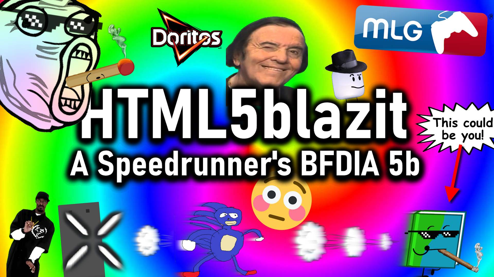

# HTML5blazit [(-> webpage link)](https://korzen10.github.io/HTML5blazit)

A fork of Imaperson's [BFDIA 5b speedrun mod](https://github.com/imaperson1060/HTML5b/) (which is a fork of Coppersalts's [HTML5b repository](https://github.com/coppersalts/HTML5b/)) that contains many new features geared to be helpful towards speedrunners! This mod is allowed on the [official speedrun leaderboard](https://speedrun.com/bfdia) as the physics and functionality are equivalent to the base game under default settings, though some of the new features are not allowed.

# Features
### *Note: list is non-exhaustive. [Check the changelog](https://korzen10.github.io/HTML5blazit/changelog.txt) to see an exhaustive list, as well as further details.*

- Autosplitter (like Livesplit)
- Upgraded input display
- Savestates
- Time warp
- Pausing
- Skip restart animation
- Advanced best time recording
- Input history recording
- More quality-of-life features 
- Category extension functionality
- Again, much more (and more to come)!
 
 

